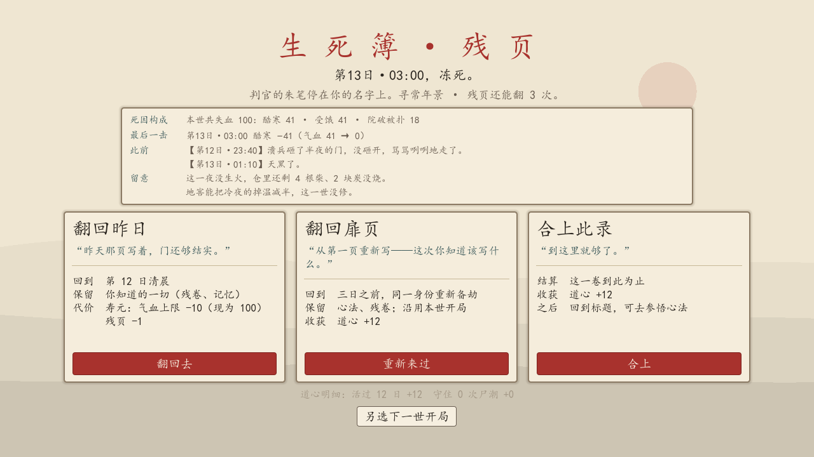

# 死因与复盘

2026-10-26。承接路线图 M5「可发布版本」里那句**玩家能理解失败原因**。验收以「死的那一刻，玩家说得出是谁、什么时候、把哪一项熬干的，下一次知道改哪」为准。

## 问题（第一性原理）

玩家死一次要付出十几分钟到半小时，**死因是他唯一拿到的反馈**。它必须满足两条：① 说的必须是真发生的事；② 说的必须能落到下一步动作上。

改前两条都不成立。死因是在 `Post._death_cause(run)` 里**事后按属性猜**的：

```gdscript
if water <= 0:  return "渴死在第 %d 日。"
if food  <= 0:  return "饿死在第 %d 日。"
if plague:      return "尸瘟入骨，死在第 %d 日。"
if warmth < 30: return "冻死在第 %d 日的夜里。"
return "力竭而亡。"
```

由此产生四类错：

1. **属性见底 ≠ 死因**。夜里被尸群扑死的人，只要饱腹刚好为 0，判词就写「饿死」——真正要了他命的是院墙。
2. **兜底那句什么都没说**。「力竭而亡。」不含日子、不含原因。翻废墟被尸群咬死、破院被扑死、强截运尸失血过多，全都落进这一句。
3. **优先级顺序本身是偏见**。渴 > 饿 > 瘟 > 冻这个顺序没有任何依据，只是写法顺序。
4. **死了以后没有下一步**。残页只给一句判词，没告诉玩家「家里还有 4 根柴没烧」「体温是几时开始掉的」。

**验收条件**：① 判词来自真实扣血，不是属性猜测；② 判词带时刻；③ 属性见底但死亡另有其因时，不得被属性抢走判词；④ 残页给出失血构成、最后一击、死前几步、一句可执行的提醒；⑤ 提醒只引用真实存在的库存/设施/破损，宁可不给也不编；⑥ 老存档不能崩，也不能被补造出假账本。

## 方案

### 1. 扣血时记账（`State.hurt`）

新增 `State.hurt(run, amount, tag)`：扣血 + 累计进 `run.hp_log[tag]` + 把这一笔记进 `run.last_hurt`（含扣前气血）。**只有扣血走它**，睡觉回血仍走 `add_attr`，不污染账本。

账本记的是**实际掉掉的血**：只剩 3 点气血时挨 40，账本记 3 不记 40。否则「最后一击 −40」会说出一个根本没掉过的数，几项相加也会超过本世总气血，把构成比灌歪。

11 处扣血点全部插桩：

| 来源标签 | 名 | 出处 |
|---|---|---|
| `starve` / `thirst` | 受饿 / 渴 | `Post._tick` |
| `plague` | 尸瘟 | `Post._tick` |
| `freeze` / `cold` | 酷寒（体温<15）/ 受冻（<30） | `Post._tick` |
| `overrun` | 院破被扑 | `Post._tick` 三面全破、`Defense.resolve_round` 进院咬人 |
| `bite` | 夜战失血 | `Post.end_fight` |
| `sortie` | 出门迎战 | `Defense.sortie` |
| `raid` | 溃兵夜袭 | `Defense.resolve_raid` |
| `wound` | 受伤 | `Explore._caught`、`Identity.act` 强截 |
| `event` | 意外 | `Events._apply` 里的负血效 |

### 2. 判词由账本生成（`DeathReport.verdict`）

优先级：**现场写好的那句**（「尸潮破门，死在第 3 夜」这类带场景的）> **账本主项** > **属性猜测兜底**（只给没有账本的老存档）。

主项取本世失血最多的一项；**平手时取最后落下的那一击**——两样各扣 41，真正把血打光的是后落下的那下。这决定了「判词说什么」与「最后一击是什么」不会自相矛盾。

顺手把两处弱判词改成读账本：`Post.end_fight` 的「死在院门口。」、`Defense.resolve_wave` 的「死在第 N 夜。」——它们本来就不带原因，账本说得更清楚。

### 3. 残页复盘（`DeathReport.report` + `dead_screen._recap`）

| 行 | 内容 | 空的时候 |
|---|---|---|
| 死因构成 | 本世共失血 100：酷寒 41 · 受饿 41 · 院破被扑 18 | 老存档没有账本 → 整块不显示 |
| 最后一击 | 第13日·03:00 酷寒 −41（气血 41 → 0） | 不显示 |
| 此前 | 死前最后两条真实日志（跳过「气血已尽」那句） | 不显示 |
| 留意 | 由真实数据推的一句（最多两句） | 没有对应事实就不显示 |

「留意」的判定表（每条都有前置条件，条件不成立就不出这一句）：

- 主因冻：没生火 → 说没生火；并说仓里还剩几根柴几块炭（剩 0 就说没了，别编）；没修地窖 → 说地窖能减半冷夜掉温。生过火但 `heat_weak` → 说一捆柴只够烧半夜。
- 主因饿：仓里还有吃的 → 说还剩几份、并点出「做一次饭要一个时辰」；仓空 → 说没有吃的了。
- 主因渴：行囊有清水 → 说还剩几瓢；有水缸 → 说打一次水一刻钟；都没有 → 说这一世没置水缸。
- 主因院破/夜战：只有真的砸到 0 的面才点名（院门/窗/院墙），完好就不提。
- 主因尸瘟：说避瘟散能压住、染上当天该去买。
- 其它来源：**不给建议**。

### 4. 存档 v21

`run.hp_log` / `run.last_hurt` 随 `State.new_run` 建立；`Migrate.VERSION` 升到 21，老档补空账本（**不补造历史**），死因退回属性猜测。快照一并升级。

## 分批交付与验收

1. 扣血记账 + 判词 + v21 迁移（core）。
2. 残页复盘（UI）。
3. `tests/death_report.gd` 66 项 + 回归 + 截图目视。
4. 路线图归档。

## 未做范围

- **装备/护具对失血的影响说明**：账本只记来源，不记「当时没穿护具」，所以不给这类建议。
- **尸瘟染上的具体日期**：`run.plague` 只是一个布尔，没有感染时刻，复盘说不清「第几日染上的」。
- **结局面（劫满/撤离/破阵）的复盘**：本期只做死亡残页，胜利结算仍是原来的道心明细。
- **因果链**（例如「第 9 日没买药 → 第 12 日染瘟 → 第 13 日死」）：需要事件订阅，超出本期。
- 老存档（v20 及以前）没有账本，只能得到属性猜测级别的判词，**这是有意的**：不补造没发生过的事实。

## 验收记录

本次实际执行的命令与结果（Godot 4.7.2，Windows）：

| 用例 | 结果 |
|---|---|
| `res://tests/death_report.gd`（新增） | **66 项检查，0 处失败** |
| `res://tests/check_scripts.tscn` | 70 个脚本，失败 0（比上批多 1 个：`death_report.gd`） |
| `res://tests/ui_smoke.tscn` | 失败 0 处（含走到死亡残页并按「翻回昨日」的整条流程） |
| `res://tests/sim_test.gd` | 测试完成 16 / 16 项，不变量失败 0；无誓约 27/40、带同院 34–35/40，与上批基线一致（改死因不改数值） |
| `res://tests/mainline_ui.tscn`（窗口模式） | Mainline UI: 354 checks, 0 failures |
| `res://tests/past_lives_ui.tscn`（窗口模式） | Past lives UI: 51 checks, 0 failures |
| `res://tests/opening_ui.tscn`（窗口模式） | Opening UI: 610 checks, 0 failures |

`death_report` 覆盖：账本累计与最后一笔、0/负数/回血不记账、缺字段不崩、饿死/冻死/院破各自的判词带日子、**属性见底但主因是院破时不得写成饿死渴死**（附老办法的对照断言）、现场判词优先、主因取最大项、平手取最后一击且构成首位与提醒同源、老档走属性兜底且不带「力竭而亡」、复盘总量/构成排序/最后一击扣前扣后/此前跳过「气血已尽」/零星失血不占行、老档复盘不编造、五类提醒的前置条件与非匹配不给建议、v20→v21 迁移（主档与快照都升级、不补假账本、旧死因保留）、真跑一次饿死并断言死因来自账本。

残页版面用一次性截图脚本（`res://tests/death_shot.tscn`，拍完即删）目视检查两轮：第一版「此前」三条拼成一行、时刻被折行切断，「留意」两行重复同一个标签，且「道心明细」被卡片下缘压住；改为一条一行、「留意」只标首行、卡高 300→270、标题 54→48、行距 14→10 后版面干净。



**未验收**：完整玩家一轮试玩（真人是否真的看懂这套复盘）、结局页复盘（本期只做死亡残页）、尸瘟感染日期、装备对失血的影响、因果链、独立安装包与 CI **NOT RUN**。本批只是 M5「玩家能理解失败原因」的一项，不等于 M5 整体验收。
