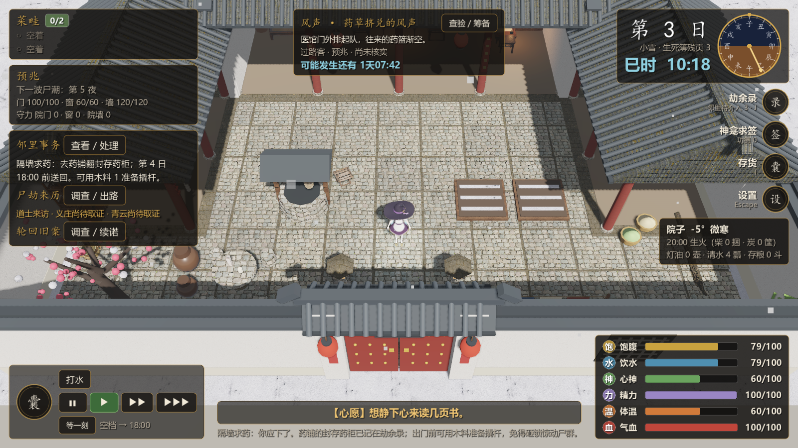

# 节奏：把「干等」从罚站变成一次按键

2026-10-26。承接路线图 M5「可发布版本」的**节奏**一项。验收标准：一局二十天里，玩家不该有大段"知道没事、但必须盯着时间流"的时间。

## 问题（第一性原理）

节奏不是"快"或"慢"，是**单位真实时间里有意义的决定数**。要判断它，得先量三件事：一天做几次决定、多少时间在等工序、多少时间纯干等。

改前没人量过。先在 `sim_test` 里加了一路诊断（`PACING=1` 打开，默认零开销、零输出），用同一个机器人跑 12 局（4 身份 × 3 种子，20 天）：

| 指标 | 实测（每天） |
|---|---|
| 玩家真的做的决定 | **3.5–4.9 次**（均值约 4.3） |
| 事件/抉择卡 | 0.3–0.8 次 |
| 等一件事做完（busy，40 分/秒） | 68–152 分钟游戏时间 |
| 睡（150 分/秒） | 590–615 分钟 |
| **干等（没活干、没人来、只能看着时间走）** | **576–651 分钟** |

一天 1440 分钟，醒着的约 850 分钟里，**73% 是干等**。换算成真实时间（1x = 4 游戏分钟/秒）：一天 6 分钟，其中约 2 分 35 秒纯粹在等；一局二十天约 **2 小时**。

结构原因很清楚：固定决策点只有 8:00 的闲话、18:00 天黑、20:00 烧炭、21:00 宵禁、22:00 尸潮、23:40 溃兵。**上午 8:00 到傍晚 18:00 这十个小时，一个强制决策点都没有**，全靠玩家自己想事情做；手上的活（做饭 60 分、营造 90 分、读书 120 分）又都只要一两秒真实时间就做完。于是剩下的几百分钟没有任何东西可点。

## 方案：等一刻

只做一件事：**把时间直接推到下一个节点**，而不是让玩家拿眼睛等。

- **节点就是既有的检查点**（`Post.checkpoints`）：8:00 / 18:00 / 20:00 / 21:00 / 22:00 / 23:40 / 天亮，开夜后还包含每一轮夜战结算点。跳过的只是"没有事发生"的分钟，**不会跳过任何事件、夜战轮次或天亮结算**——`Post.advance` 本来就在检查点前刹车。
- **该拒绝的时候拒绝**：手头正在做事、正在睡、有事件/夜报/天亮待处理时，`minutes_to_next_stop` 返回 0，按键只提示「手头有事，等不了」，不会把带选择的时刻冲过去。
- **看得见**：HUD 速度按钮下面一行是「等一刻」按钮 + 「空档 → 18:00」，玩家随时知道下一次停下来是几点。快捷键 **Q**（进 `InputMap`，可在设置里改）。
- 顺手把流速数值搬进 core：`Post.SPEEDS` / `Post.BUSY_RATE` / `Post.SLEEP_RATE` / `Post.rate()`。这几个数是节奏数值，不是皮肤；搬进 core 之后能无界面断言，界面只剩「问一句、显示一下」。

### 为什么不用别的办法

| 备选 | 不采用的理由 |
|---|---|
| 直接提高基础速度（1x 从 4 提到 8） | 玩家不该被逼着开 3x 才不无聊；想看细节的人反而被动 |
| 空档时自动加速 | 需要判断"玩家没事可做"，而"能做事"和"想做某事"不是一回事；玩家在犹豫时被抢走时间比干等更糟 |
| 往白天塞更多内容填满 | 那是 M2/M3 的活（新配方、新交易、新调查），要玩家验收；本批只解决"等"这件事 |

## 分批交付与验收

1. 诊断（`sim_test` 的 PACING 开关）——量出上面的数。
2. core：`minutes_to_next_stop` + `rate`/`SPEEDS` 迁入。
3. 输入：新动作 `wait`（Q），进设置界面的改键表。
4. 界面：HUD「等一刻」按钮 + 空档提示。
5. `tests/pacing.gd` + `ui_smoke` 补按钮闭环 + 截图目视。
6. 路线图归档。

## 未做范围

- **真人试玩**：这批能证明"按键确实把时间推到节点且不乱跳"，不能证明"玩家因此觉得节奏好了"。这是只有玩家能答的问题，**NOT RUN**。
- **事件密度**（0.3–0.8 次/天）没动；白天要不要再多几个可选的事，属于内容，需要设计 + 玩家验收。
- **自动快进**（无事可做时提速）没做，理由见上表；等真人反馈后再说。
- 干等里有一部分是"等天黑前没事做"，也有一部分是"等尸潮"——后者有紧张感，本批没有区分，只是统一可跳。
- 手柄/鼠标绑「等一刻」：捕获层只做键盘（与 doc 24 一致）。

## 验收记录

本次实际执行的命令与结果（Godot 4.7.2，Windows）：

| 用例 | 结果 |
|---|---|
| `res://tests/pacing.gd`（新增） | **33 项检查，0 处失败** |
| `res://tests/check_scripts.tscn` | 70 个脚本，失败 0 |
| `res://tests/ui_smoke.tscn` | 失败 0 处（新增：开劫后按「等一刻」，断言时间真的推到 8:00 的检查点） |
| `res://tests/input_settings.gd` | 101 项检查，0 处失败（默认绑定合同里多了 `wait` = Q） |
| `res://tests/settings_ui.tscn`（窗口模式） | 54 项检查，0 处失败（改键表 18 行，在滚动容器里） |
| `res://tests/mainline_ui.tscn`（窗口模式） | 354 checks, 0 failures |
| `res://tests/sim_test.gd`（`PACING=1`） | 测试完成 16 / 16 项，不变量失败 0 |

`pacing.gd` 覆盖：三档流速与越界夹紧、睡眠/做事各自的快档、三档下一天的真实秒数（360 / 144 / 60）、六个时刻的下一个节点、站在节点上要算下一个、做事/睡觉/事件/天亮四种情况下拒绝跳、跳完真的停在 8:00 与 18:00、开夜后夜战轮次也是节点。

### 跳完之后：玩家一天要按几下

同一路诊断还统计了「空档段数」——一次等一刻能吃掉一段。19 局实测：**每局每天 0.9–1.1 段**，也就是整天的空档是**一整段连续的**，按一次「等一刻」就能吃掉那 600 分钟，而不是零零碎碎按二十次。这是这批改动能成立的关键：如果空档是碎片化的，一个"跳到节点"的按钮就不会有用。

### 界面

HUD 速度按钮下面一行是「等一刻」+「空档 → 18:00」。第一版把按钮和提示塞在速度按钮同一行，撞上了底部居中的心腹条（截图里能看到被压住），改成另起一行；提示文字也从「空档 → 18:00（Q 等一刻）」缩成「空档 → 18:00」，按键说明只留在悬浮提示里。

**未验收**：真人试玩（这批证明"按键把时间推到节点且不乱跳"，不能证明"玩家因此觉得节奏好"）、事件密度、白天内容量、自动快进，全部 **NOT RUN**。本批只是 M5「节奏」的一条，不等于 M5 整体验收。
