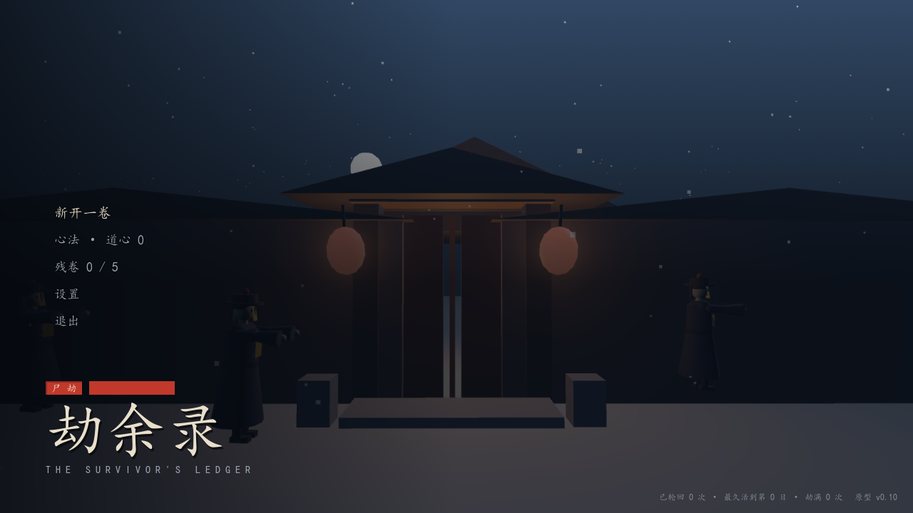

# Windows 打包

2026-10-26。承接路线图 M5「独立安装包」。验收标准：**给一个不会装 Godot 的人一个文件夹/一个 exe，双击就能玩**。

## 问题（第一性原理）

现在能玩的唯一方式是 `启动游戏.bat` —— 它指向 `tools/godot/` 里那台引擎（255 MB，**不入库**）。也就是说：仓库本身跑不起来，别人拿到代码也玩不了；没有可分发的东西，就谈不上试玩反馈。

## 前置条件（这批最硬的一堵墙）

Godot 出独立 exe 必须有**导出模板**（`%APPDATA%\Godot\export_templates\<版本>.stable\`）。当前机器上是空的。

实测下载速度：`Godot_v4.7.2-stable_export_templates.tpz` 约 **47 KB/s**，7 分钟只下到 20 MB，而这个包是 GB 级 —— 按这个速度要几小时。**本批没有等它**，改为交付「不需要模板也能出可玩产物」的路径，并把装模板的步骤写成一行命令（见文末）。

## 方案：两种产物，一个脚本

`tools/build_windows.ps1`，`-Mode auto|release|portable`：

| 模式 | 产物 | 需要模板 | 体积 | 用途 |
|---|---|---|---|---|
| `release` | `劫余录.exe`（真独立程序） | 要 | 约 50–80 MB | 正式分发 |
| `portable` | `劫余录.exe` + `劫余录.pck` + `读我.txt` | **不要** | 约 375 MB | 立马能玩、验打包完整性 |

`auto` 会先看模板在不在：在就出 release，不在就退 portable 并说明差别。

便携包的原理：`--export-pack` 只打包资源、不需要模板；把 `.pck` 与运行时**同名**放在一起，双击 exe 就自动挂载。代价是运行时只能用仓库里那台编辑器二进制（带编辑器、体积大）。

导出预设 `export_presets.cfg` 这次**从 .gitignore 里放出来了**：发布件的参数（架构、嵌入 pck、图标、公司名、排除哪些目录）属于工程，不该是某台机器的私有状态。两个预设：

- `Windows Desktop`：发布用，排除 `tests/ tools/ docs/ .workbuddy/`，`embed_pck=false`（pck 单独放，便于替换/校验）。
- `Windows Desktop (console)`：验证用，**包含 tests**，带控制台外壳、pck 内嵌 —— 这样可以在打包后的运行时里跑 `res://tests/export_smoke.tscn`。

## 打包揪出的真问题：档案写到只读的 res://

`Game.resolved_memory_path()` 原来固定返回 `res://Memory.md`。开发时 `res://` 就是磁盘上的项目根，写得进去；**打包后它在 pck 里，只读**——于是每次存档都会弹一条「前世档案 Memory.md 未能写入」，而且是每次。

改法不是判"是不是打包版"，而是判"这里到底能不能当档案目录"：

```gdscript
static func res_is_readonly() -> bool:
	if OS.has_feature("template"):   # 真导出件一律只读
		return true
	return not res_writable()        # 开发时探一下磁盘（项目放在只读盘上也该退）
```

`res_writable()` 往 `res://.write_probe` 写一次再删掉，结果缓存一次进程只探一次（探针文件也进了 .gitignore）。两道都留着是因为单靠任何一道都会漏：`OS.has_feature("template")` 在"编辑器二进制加载 pck"这种模拟里是 false，而探针在真 pck 里本该失败、实际上编辑器二进制却能写成功。

只读时档案落 `user://Memory.md`（打包后就是 `%APPDATA%\Godot\app_userdata\劫余录\Memory.md`）。

## 验收记录

| 检查 | 结果 |
|---|---|
| `tests/export_smoke.tscn`（开发环境） | **9 项检查，0 处失败**（res:// 可写 → 档案落项目根；数据表在；存档往返可写） |
| 同一个场景，在**验证包**（含 tests 的 pck）里跑 | **9 项检查，0 处失败**（数据表进包、`user://` 存档可写、`res://.write_probe` 探完即删） |
| 发布包不该带测试（负例） | `劫余录.exe --main-pack 劫余录.pck res://tests/export_smoke.tscn` → `Cannot open file 'res://tests/export_smoke.tscn'` ✔ |
| 便携包启动 | `劫余录.exe --headless --quit-after 90` → 0 条 script error / 资源加载失败 |
| 便携包渲染 | 在 pck 里实例化 `main.tscn` 出一帧标题图，3D 远景、灯笼、人物、中文字体全在（`docs/28-export-title.png`） |
| `tools/build_windows.ps1 -Mode portable` | 出 `build/windows/劫余录.exe`（172.5 MB）+ `劫余录.pck`（201 MB）+ `读我.txt` |

脚本本身踩过一个坑：PowerShell 5.1 按 ANSI 读脚本，UTF-8 无 BOM 的中文会乱码到解析失败 —— **这个 .ps1 必须存成 UTF-8 with BOM**（已改）。



## 未做范围

- **真正的 `release` exe 没有产出**：导出模板没装齐（下载太慢）。这是本批最大的缺口，`-Mode release` 会在模板到位后直接可用，但**没有实跑过**。
- **安装器**（Inno Setup / NSIS）、开始菜单快捷方式、卸载项：都没做。现在交付的是"便携文件夹"，不是带安装流程的安装包。
- **图标**：预设里 `application/icon` 仍为空，exe 用的是 Godot 默认图标。
- **代码签名**：没做，Windows 首次运行会有 SmartScreen 提示。
- **体积治理**：375 MB 里大头是编辑器二进制和 201 MB 的 pck（项目有 1.7 GB 素材，导出只带引用到的）。release 出来后应回到 100 MB 上下，但**没有实测**。
- **Steam / 云存档 / 崩溃上报**：没做。
- 打包后的**完整一轮试玩**（存档、读档、轮回、结局）没有在便携包里人工走过；只验到"能启动、能渲染、数据表在、存档可写"。

## 装模板的命令（下次接上）

```powershell
# 1. 下载（GB 级，慢）
curl -L -o templates.tpz https://github.com/godotengine/godot/releases/download/4.7.2-stable/Godot_v4.7.2-stable_export_templates.tpz
# 2. 解压，把里面的 templates\*.* 放进（脚本会打印这一路径）
#    %APPDATA%\Godot\export_templates\4.7.2.stable\
# 3. 出正式件
powershell -File tools\build_windows.ps1 -Mode release
```
