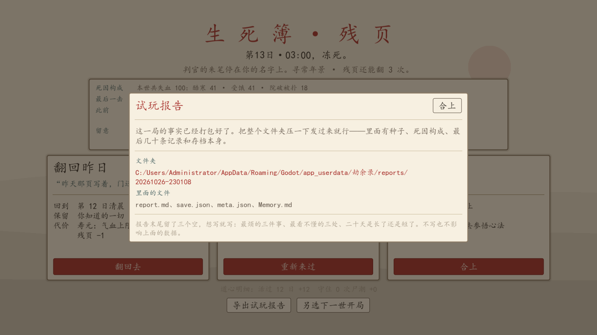

# 试玩反馈：把感受变成能复现的东西

2026-10-26。M5 的最后一项是「试玩反馈」。真人坐在屏幕前的感受只能由人来给，但这批能做的是**把反馈变成可复现、可定位的证据**，而不是一句「有点难」。

## 问题（第一性原理）

试玩反馈的价值不在于「玩家喜欢不喜欢」，在于**我们能不能照着它把问题复现出来**。玩家发来「第 12 天突然就死了」，能拿它做什么？什么也做不了。但如果他发来种子、难度、死因构成和最后几十条记录，我们能在本地把那一局打开、把同一个时刻重放一遍。

所以这批交付的是**取证机制**，不是收集意见的渠道。

| 玩家常说的话 | 缺的东西 | 报告里对应的字段 |
|---|---|---|
| 「第 12 天突然就死了」 | 种子、难度、当天的账 | 种子、难度、死因构成、最后一击、最后 40 条记录 |
| 「不知道该干嘛」 | 当时手头有什么、能做什么 | 当时的气血/日期时刻、最后几条记录、当时本可以做（余地提示） |
| 「太长了 / 太赶了」 | 一局实际走了多久 | 第几日、世次、底稿里的轮回次数与最久存活 |
| 「我改了键结果乱了」 | 改过哪些 | 本机设置里的改键清单 |
| 「这游戏是不是坏了」 | 版本与平台 | 版本、引擎版本、系统、分辨率、存档大小 |

报告**只写事实**：没有扣血账本就写「没有掉血记录」，不拿属性去猜死因；没有进行中的局就说没有。主观感受留在报告末尾的三个空行里，玩家愿意写就写。

## 交付

### 1. 报告生成（`scripts/core/playtest_report.gd`，纯逻辑、可无界面测）

Markdown 文本，五段：这一局 / 死因构成 / 最后 40 条记录 / 跨轮回底稿 / 本机设置 + 三个待填问题。

刻意做的三件事：

- **日志只留末尾 40 条**：全量发过来没人看，40 条足够看出「死前几步在干什么」。
- **不带本机路径与用户名**：报告是文本，会被随手转发；除了系统名和分辨率，不把机器细节带出去。
- **余地说人话**：死因段直接复用上一批的「当时的余地」（有柴没烧、仓里有米没做饭、院门砸穿没补），玩家自己就能看出来下次改什么。

### 2. 一键导出（`Game.export_playtest()`）

在 `user://reports/<时间戳>/` 下生成一个文件夹：

```
report.md           ← 上面那份报告
save.json           ← 这一局的存档（能原样打开）
save.json.bak       ← 有的话一起带上
meta.json           ← 跨轮回底稿
Memory.md           ← 前世档案（有的话）
```

界面上弹出文件夹的绝对路径和文件清单——路径很长、toast 会消失，所以用弹窗而不是提示条。

### 3. 三个入口

| 位置 | 为什么在这 |
|---|---|
| 标题界面 →「导出试玩报告」 | 没开新局时也能导（只有底稿与设置） |
| 生死簿残页底部 | **玩家最想吐槽的就是这一刻**，而且此时存档还在 |
| 结局面底部 | 劫满/撤离/破阵之后的观感 |

死亡页的按钮不能只放标题界面：**「合上此录」会删掉存档**，等玩家回到标题再导，那一局的存档已经没了。这是这批唯一一个"不做就白做"的设计。



## 拿给人试玩时怎么问

一局大约 15–25 分钟（1x 跑二十天约 2 小时，看玩家开几档）。建议让试玩者只做三件事：

1. **从头开一局，不许看攻略**，卡住就直接说「我卡住了」，不要硬撑。
2. 死一次以后，**先看残页的复盘**，问他一句：「你知道自己是怎么死的吗？」——答不上来就是死因那块的失败。
3. 玩到第 10 日左右停下，问：「现在还有你想做但做不了的事吗？是什么拦着你？」

然后让他点「导出试玩报告」，把整个文件夹发回来，报告末尾三个空行能填就填。

## 验收记录

| 用例 | 结果 |
|---|---|
| `res://tests/playtest_report.gd`（新增） | **31 项检查，0 处失败** |
| `res://tests/playtest_export.tscn`（新增） | **14 项检查，0 处失败** |
| `res://tests/check_scripts.tscn` | 71 个脚本，失败 0 |
| `res://tests/death_report.gd` | 66 项检查，0 处失败（余地措辞改成只剩柴时不再写「0 块炭」） |
| `res://tests/ui_smoke.tscn` | 失败 0 处 |

`playtest_report` 覆盖：空档报告（说清没有局、有底稿与问题）、死局报告（身份/难度/种子/判词/失血构成/战果）、日志只截末尾 40 条、老存档没账本时不编失血与最后一击、结局局写结局而不是身死、ctx 缺字段时占位不崩、报告里不出现本机路径与用户名。

`playtest_export` 覆盖：空档也能导、开了局之后报告 + 存档 + 底稿都在文件清单里、报告含身份与种子、附上的 save.json 能解析且是同一局、导完把目录与空的 reports/ 收干净。

## 未做范围

- **在线提交 / 崩溃上报 / 遥测**：没有后端，靠玩家手动发文件夹。真要上架得另做。
- **自动截图**：报告不带画面，遇到渲染问题还得让玩家自己截。
- **失败原因之外的主观项**：三个问题是开放式的，没有量表；要结构化打分得再设计。
- **本批的"试玩"是空转的**：报告能导出、内容经断言，但**没有真人拿它试玩过一轮**——这条只能等。
- 报告不含玩家的操作序列（点击流），所以「为什么卡住」仍需玩家一句话描述。
