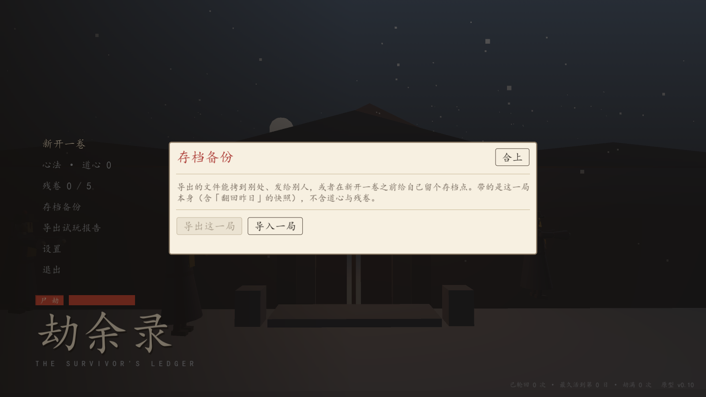

# 存档备份与搬运（.jyz）

2026-10-27。接着 [25 存档安全](25-save-safety.md) 往下做，补上路线图两处都提到的缺口：**多存档槽与存档导出**。

## 问题（第一性原理）

现在的存档只有一份，而且和这一局同生共死：

- 一局玩到第 15 日，想换个身份试试 → 只能「合上此录」，**这一卷永久没了**。
- 想把这局给朋友看、或者从台式机搬到笔记本 → 没有文件可搬（存档藏在 `%APPDATA%` 里，还得连 `.bak` 一起说清楚）。
- 想给自己留个"第 10 日的存档点"再往下试 → 做不到，只有「翻回昨日」那一天的快照。

所以这批交付两件事：**能把一局导出成文件**，**能把文件导回来并顶掉当前局（但先自动留档）**。

## 方案：信封而不是裸 JSON

`.jyz` 是一个缩进 JSON 信封：

```json
{
	"format": "jieshi-save",
	"format_version": 1,
	"exported_at": "20261027-1250",
	"game_version": "0.10.0",
	"run_version": 21,
	"data": { "run": { … }, "snapshots": { … } }
}
```

三个理由：

1. **分得清**。裸 JSON 没法判断"这是存档还是别的 json"；信封有 `format` 标记。
2. **说得清版本**。`format_version` 是信封自己的版本，`run_version` 是里面那局的结构版本——两者独立演进。未来版本的信封会被拒绝并说明「这份存档来自更新的版本」。
3. **能自己看**。缩进 JSON 用记事本就能读，出问题可以肉眼查；这是这个项目一贯的做法（存档、报告都是可读文本）。

导入时走和读档**同一条迁移**（`Migrate.save`），所以 v20 的老包导进来会被补字段并标记「已自动升级」。

### 导入前自动留档

导入是"顶掉当前一局"的操作。没有让它弹「确定要覆盖吗」，而是**直接把手上这一卷另存到 `user://backups/导入前-<时间>.jyz`**，导入成功后把路径告诉玩家。

理由：确认弹窗只在"玩家看得懂自己要失去什么"时才有效，而这里他很可能刚玩了两小时、脑子还在上一局里。自动留档是**不需要玩家做对选择**的方案——真想回去，导回来就行。

## 界面

标题界面 →「存档备份」：一句说明 + 两个按钮（导出这一局 / 导入一局），各自打开系统的文件选择框。

- 没有进行中的局时，「导出这一局」是灰的（导入仍然可用——这正是没档的人最需要的）。
- 导入完成直接落到对应的页面：进行中回宅院、死了回残页、了结回结局（`Game.screen_for_run()`）。



## 为什么没做多存档槽

真正的多槽要改开局流程和标题菜单（"续写哪一卷"要先选槽），而**工作树里另一位写入者正在改庭院与城市远景**（`scripts/world/` 与标题背景），同一个界面区域同时改冲突概率高。而"导出/导入 + 导入前自动留档"已经覆盖了绝大多数需求：想留档点就导一份，想换身份就导完再合卷。

槽位 UI 留给后面单独一批，前提是玩家真的需要"随时在几卷之间切换"而不是"留个备份"。

## 验收记录

| 用例 | 结果 |
|---|---|
| `res://tests/save_pack.gd`（新增，纯逻辑） | **38 项检查，0 处失败** |
| `res://tests/save_pack_io.tscn`（新增，落盘） | **21 项检查，0 处失败** |
| `res://tests/ui_smoke.tscn` | 失败 0 处（新增：标题界面的备份弹窗有两个入口，无档时导出按钮是灰的） |
| `res://tests/check_scripts.tscn` | 74 个脚本，失败 0 |

`save_pack` 覆盖：导出→导入往返（种子/天数/身份不变）、信封五个字段、七种坏文件各自被拒且都说人话、版本太新与"不是存档"的话术不同、v20 老包导入后升级到当前版本且天数不丢、快照跟着走（否则翻不回昨日）、默认文件名含天数与身份且过滤 `/\:*?"<>|`、备劫阶段的文件名。

`save_pack_io` 覆盖：导出→换一局→导回来（天数、身份、日志标记都回来）、导入前确实留了档且文件存在、坏文件被拒且**现有的一局一个字段没动**、缺文件的话术、`screen_for_run()` 三种阶段各回各页。

## 未做范围

- **多存档槽的界面**：只有一份当前档 + 手动导出的备份文件，没有"选槽"。
- **跨轮回底稿（meta.json）不随存档走**：导出的是一局。换机器只有这一局、道心与残卷仍是新的——这会让"前世记忆"看起来断了一截。要不要连底稿一起导，属另一个设计（底稿是账号级的，覆盖它比覆盖一局危险得多）。
- **备份目录的管理**：`user://backups/` 只增不删，没有列表、没有清理、没有"从备份恢复"的入口。
- **云同步 / Steam 云**：没做。
- 导入时的**版本兼容面**只测了 v20→当前；更老的包（v10 以前）没造样本。
