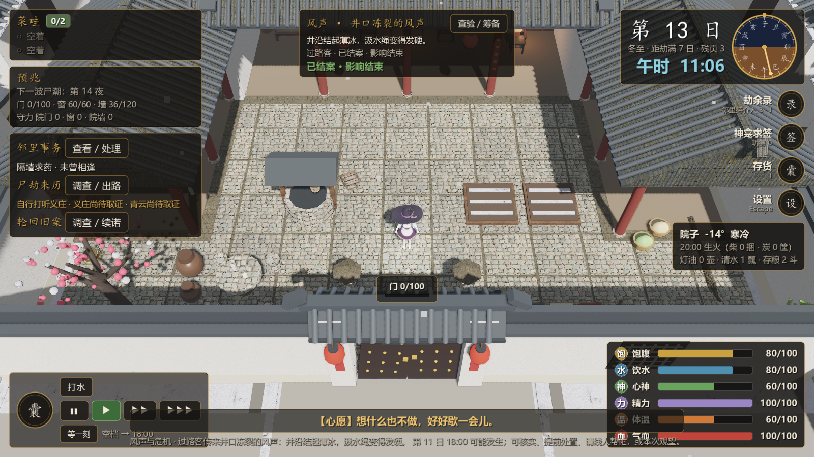
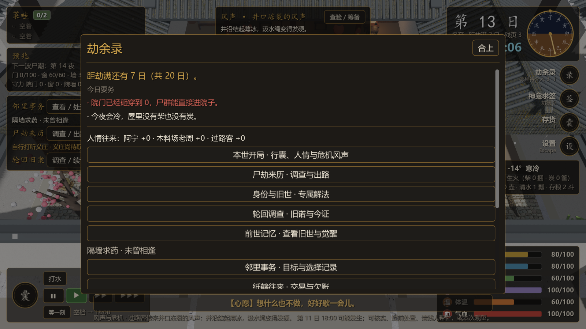

# 目标与今日要务

2026-10-27。M5 的验收标准原话是「完整流程稳定且玩家能理解**目标**和失败原因」。失败原因做过了（[26](26-death-recap.md)），这批补前半句。

## 问题（第一性原理）

玩家走完备劫、进了宅院，只剩一个问题要回答：**今天做什么才不会死**。改前他拿不到答案：

- HUD 只写「第 13 日」，**从没说终点是第 20 日**。「劫满」这个词只在结局和路线图里出现。
- 左上是「危机」面板，写的是**世界**的状态（下一波尸潮第几夜、三面还剩多少、哪个时钟在走）。它回答的是"外面怎么了"，不是"我该干什么"。
- 「劫余录」里全是入口按钮（人情、主线、身份、轮回调查……），打开以后才知道自己缺什么。

也就是说：**信息都在，但没有人替玩家把它们合成一句话**。这正是"不理解目标"的样子——不是缺数据，是缺归纳。

## 方案：`scripts/core/brief.gd`

一个纯逻辑模块，只做归纳，不新造规则、不新造数值：

```gdscript
Brief.goal(run)       # 「距劫满还有 7 日（共 20 日）。」
Brief.countdown(run)  # 「距劫满 7 日」/「守到死」/「3 日后尸劫」
Brief.progress(run)   # 0..1
Brief.lines(run)      # 今日要务，最多 4 条，按紧急度排序
```

「今日要务」的六条判断，全部读既有字段：

| 条件 | 说法 | 级别 |
|---|---|---|
| 三面里有 `cur <= 0` | 「院门已经砸穿到 0，尸群能直接进院子。」 | 要命 |
| 今夜有尸潮且最弱一面 `< 30%` | 「今夜有尸潮，院墙只剩 20%。」 | 要命 |
| 今夜有尸潮（三面还算完整） | 「今夜有尸潮：天黑前把门窗墙补齐、守具摆好。」 | 要紧 |
| 仓里没有粮 | 「仓里没有能下锅的东西了。」 | 要命 |
| 没有存水且没有水缸 | 「没有存水，也没有水缸；渴起来只能去井边。」 | 要紧 |
| 夜里会冷且柴炭皆无 | 「今夜会冷，屋里没有柴也没有炭。」 | 要紧 |
| 只剩 1 份柴炭且没生火 | 「只剩 1 份柴炭，一捆柴只够烧半夜。」 | 提醒 |
| 以上都不成立 | 「眼下没有急事，可以把日子往前过。」 | 提醒 |

**宁缺勿编**：条件不成立就不出这条。提示文案错了比没有提示更糟——玩家会按错误的信息去准备（这也是为什么它放在 core 而不是界面里：能无界面断言）。

「最多 4 条」是刻意的：日记式的清单没人看，四条以内玩家才读得完。

## 界面上的两处

1. **HUD 日期块**：`第 13 日` 下面那行从「小雪 · 生死簿残页 3」变成「小雪 · **距劫满 7 日** · 残页 3」。不改高度、不加行——那条竖着的 HUD 已经很挤了。
2. **劫余录面板顶部**：先给一句目标，再给「今日要务」。朱砂是要命、墨色是要紧、淡色是提醒。





## 验收记录

| 用例 | 结果 |
|---|---|
| `res://tests/brief.gd`（新增） | **39 项检查，0 处失败** |
| `res://tests/check_scripts.tscn` | 75 个脚本，失败 0 |
| `res://tests/ui_smoke.tscn` | 失败 0 处（劫余录面板改了顶部，整条流程仍然通） |

`brief` 覆盖：空档与备劫阶段（备劫只说目标、不出劫中要务）、太平的一天只说一句「没有急事」、三面砸穿点名且三面全破时合成一句、今夜尸潮的分支（点名最弱一面并给百分比）、冷夜缺燃料的三档（没有 / 只剩一份 / 备够了就不提）、断粮断水（有水缸不算缺存水）、最多四条且按级别降序、倒计时的三种形态（寻常/最后一天/守到死）、进度 0..1。

## 未做范围

- **没有做新手引导**：这批只是把事实归纳到界面上，没有"第一次玩时逐步教你"的流程。玩家仍然要自己在备劫界面点两下才明白"尸劫要来了"。
- **没有引导视线**：要务只出现在劫余录里（按 J 才看见），没有弹窗、没有高亮、没有"你还没修门"的红点。要不要更主动，等真人试玩反馈再定——主动提示太强会变成唠叨。
- 判断项只覆盖了"会立刻死"的六类；约定到期、主线进度、身份解法这些**不做**在要务里，它们在各自的入口里（避免四行里塞进一堆"可以做"的事）。
- 没有为"守到死"模式调整要务（它的目标句变了，但判断项一样）。
- 真机试玩未做：玩家是否真的会按 J 看这几行，只能等人答。
