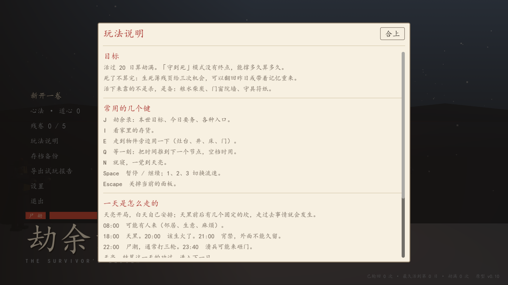

# 玩法说明与首次提示

2026-10-27。接着 [33 目标与今日要务](33-goal-brief.md)：那批解决的是"今天该做什么"，这批解决"这游戏到底怎么玩"。

## 问题（第一性原理）

游戏里此前**没有任何一处讲规则**。设置界面有改键表，但那只是键位；`doc 24` 是给开发看的。玩家拿到的只有界面上零散的事实。

具体缺什么：没人告诉他 **22:00 会来尸潮**、**活过 20 日算劫满**、**渴掉血比饿快**、**三面会被砸穿**、**尸毒不会自己好**。缺这些，他第一局基本是瞎玩——而且会在完全不明白原因的情况下死掉。

## 方案：只讲规则，不讲策略

`scripts/core/manual.gd`，四组：

| 组 | 讲什么 |
|---|---|
| 目标 | 活过 20 日算劫满；「守到死」没有终点；残页给三次机会；活下来靠备不靠杀 |
| 常用的几个键 | J 劫余录 / I 存货 / E 交互 / Q 等一刻 / N 就寝 / Space 暂停 / Esc 关面板 |
| 一天是怎么走的 | 08:00 有人来、18:00 天黑、20:00 生火、21:00 宵禁、22:00 尸潮、23:40 溃兵、天亮结算 |
| 会要命的那几样 | 渴 > 饿 > 冻的掉血顺序；体温 30 / 15 两条线；地窖减半掉温；三面砸穿后果；精力限制；尸毒不会自愈 |

三个刻意的决定：

1. **不写"该买什么"**。「米要几斗、柴要几捆」是策略，而且我算不准（粮食换算成饱腹、做饭损耗、出门搜刮补给都会影响）。写死在说明里而算错，比没有说明更糟——所以说明只有"会发生什么"，断言里也钉住了不许出现「买」「推荐」「斗米」这类词。
2. **键位不写死**，一律走 `InputCfg.first_key_name()`。玩家把 J 改成 Y，说明里就显示 Y。这条有测试：临时改键后渲染结果必须跟着变。
3. **「常用的几个键」放在第二组**。第一版它排最后，结果在折叠线以下——最该被看到的一组反而要滚屏才能找到。

## 首次提示

第一次进劫中（`meta.seen_manual` 没设过）发一条提示条：

> 按 J 看今日要务；标题界面有「玩法说明」。

**用的是提示条而不是弹窗**：进劫中这一刻正好是事件、夜报、天亮结算排队出现的时候，再弹一个说明窗会把真正的要紧事压在下面。提示条不抢焦点，玩家想看就去看，不看也不挡路。

## 验收记录

| 用例 | 结果 |
|---|---|
| `res://tests/manual.gd`（新增） | **87 项检查，0 处失败** |
| `res://tests/check_scripts.tscn` | 76 个脚本，失败 0 |
| `res://tests/ui_smoke.tscn` | 失败 0 处（首次提示是提示条，不挡流程） |

`manual` 覆盖：四组都有标题且不重复、每行非空且不超过 60 字、总行数有上限、**七条关键规则必须在文案里**（20 日 / 22:00 / 18:00 / 体温 / 尸毒 / 精力 / 砸穿）以及对「守到死」和「三次机会」的说明、引用的动作都真实存在于 `InputCfg.ORDER` 且都有默认键、改键后说明里的键位跟着变、恢复默认后回去、文案里不许出现策略建议。

## 未做范围

- **没有分步新手教程**：不是"跟着我做"的引导，只是一份随时能翻的说明。第一局仍然靠自己读。
- **没有就地提示**：走到井边不会弹"这里能打水"，界面元素也没有首次高亮。要做的话得给每个交互点挂提示，工作量和噪音都大。
- **没有策略建议**（有意）：不告诉玩家买多少米、先修门还是先囤柴。等真人试玩反馈再决定要不要给一个"备劫清单"，因为那时候才有依据判断玩家到底卡在哪一步。
- 说明是静态文本，不随难度/身份/模式变化（守到死只改了一句）。
