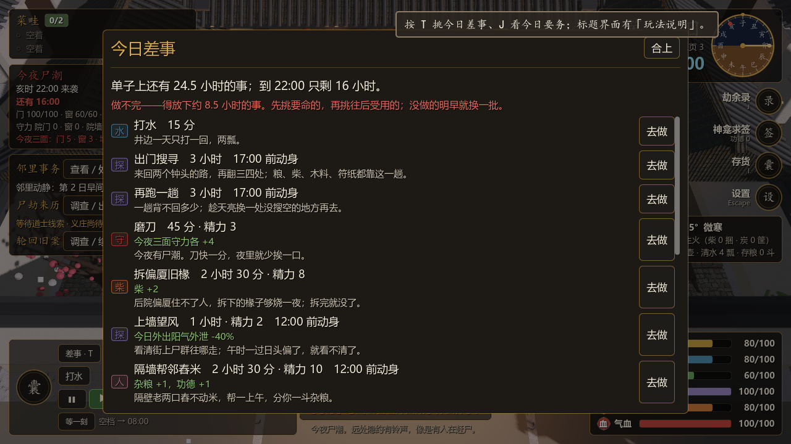
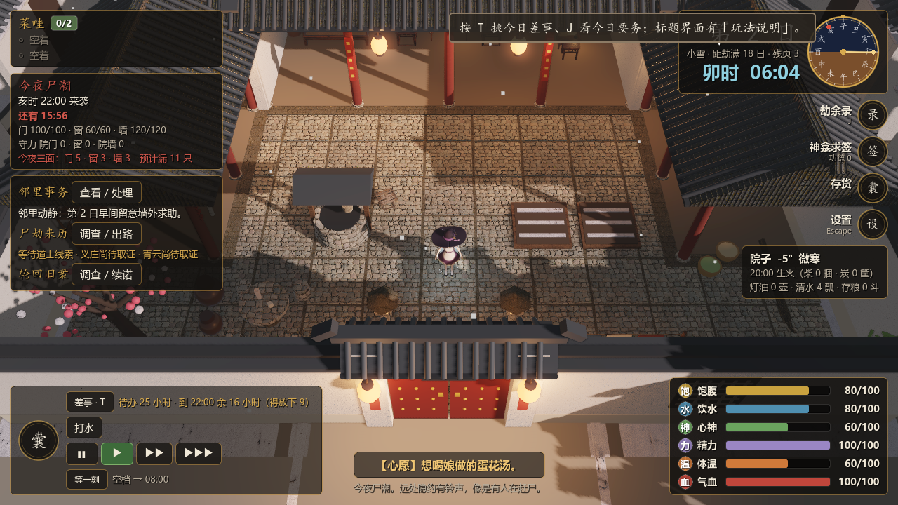

# 今日差事：二十四个钟头的事，十六个钟头做

2026-10-27。玩家反馈："一天就一直发呆，不知道该做什么。应该把一天规划好——24 小时里该有 36 小时的内容，这样就必须取舍。"

## 问题（第一性原理）

[27](27-pacing.md) 量过：醒着约 850 分钟里，600 分钟左右是干等。「等一刻」把干等变成一次按键，但没回答真正的问题——**白天拿时间能换什么**。

拆开看，发呆有两层原因：

1. **看不见**：能做的事散在院里九个物件的菜单里，要一个个点开才知道；做什么、花多久、换来什么，没有地方一起摆出来。
2. **真没有**：手上没料的时候（这正是最该忙的时候），院里几乎没有"只花时间就有收获"的活；修门要木料、做饭要米、画符要符纸，料一断，人就只能干坐。

所以验收条件定成三条，都能量：

| 验收 | 标准 |
|---|---|
| 单子够满 | 每天卯时排出的差事 ≥ 醒着可用时间（6:00–22:00，16 小时）的 **1.5 倍**，**穷到一无所有、一次性的活全做完的情形也一样** |
| 做了有用 | 每件差事都落到状态里（柴、水、守、暖、熟练、工程），做不了的说清为什么 |
| 真的要挑 | 同一个机器人带不带差事单各跑整局：白天干等大幅下降，而且单子做不完 |

## 方案

### 一张单子

每天卯时（`Post.begin_day`）排一张「今日差事」，两类事：

- **既有行动**：打水、做饭、浇水收成、修缮、出门搜寻（能去两处以上就列两趟）、加工、读书——今天做得成才列（`Post.agenda_offers` 只看料和条件）。做过一回就自动勾掉，不管是从单子上点的还是直接点物件做的。
- **新差事**（`data/chores.json`，29 条）：只花时间和精力、不靠囤货的活。

| 类 | 差事 | 换来什么 |
|---|---|---|
| 柴 | 扫拾枯枝（一局 6 回）、拆偏厦旧椽（3 回）、劈柴（耗木料） | 柴；拾完拆完就没了，劈柴要拿修门的木料换 |
| 水 | 多挑一担水、化雪烧水（耗柴，大雪后） | 清水；化雪是拿柴换水 |
| 守 | 拆杂物顶门（有破损时）、磨刀（尸潮夜） | 最破的一面 +20；今夜三面守力各 +4 |
| 暖 | 絮棉衣（大雪后）、缝补被褥、煨姜汤（耗柴） | 今夜体温少掉四成；体温、心神 |
| 工 | **盘火炕（4 回）、加高院墙（4 回）、加厚门板（3 回）** | 分几天做完，永久：睡着时少掉四成体温 / 墙上限 +30 / 门上限 +25 |
| 艺 | 练刀、琢磨营造、琢磨刀工、翻土、画街巷图 | 五门熟练各有一条 |
| 神 | 抄经、洒扫、写家书、吐纳调息（受伤时） | 心神、功德、气血 |
| 人 | 帮邻舂米（午前）、分一张饼（辰时前）、陪同院的人 | 杂粮、功德、心神 |
| 探 | 上墙望风（午前） | 今日外出阳气外泄 -40% |
| 材 | 拆旧床板（2 回） | 木料 |

**排单规则**：先放既有行动，再放"跟眼前处境挂钩"的差事（有 `need` 的：今夜有尸潮、门破了、天冷、受伤），最后按权重抽日常差事，直到总时长 ≥ 1440 分钟（`Agenda.TARGET` = 16 小时 × 1.5）。抽签用自己的种子（局种子 + 第几日），**不动 `run.rng_n`**——加了差事单，事件、搜寻、夜战的随机结果一个都不变。

**工程**是这批专门为"穷的时候"加的：盘火炕、加高院墙、加厚门板都不要料，只要时间，而且是往后每一天都受用的投资。今天先保命还是先打底，是单子上最典型的取舍。

### 时间是账

- HUD 左下常驻一行：「待办 25 小时 · 到 22:00 余 16 小时（得放下 9）」，随时间实时变。
- **T** 打开「今日差事」弹窗：每行写清花多久、耗什么、换什么、为什么值得做、几点前得动身；「去做」会让人走到对应物件跟前再开工（既有行动转给原来的菜单或弹窗）。
- 天亮翻过功过格后提示一句「今日差事 N 件、共 X 小时，醒着只有 16 小时——按 T 挑着做」。
- 没做的明早换一批；有时辰的（午前、辰时前）过了就灰掉。

### 不让差事坑人

- 尸潮夜 22:00、天亮 6:00 都会打断手上的活（料白扣），所以**做不完的不让开工**（「亥时尸潮前做不完」「天亮前做不完」）；夜战还没打完也不让开工，免得把夜里的补墙、贴符卡死。
- 同一种效用不重复给（已求到六丁六甲就不能再磨刀叠守力）。
- 井口冻裂时挑水也挑不上来，跟打水同一个规矩。

## 数值是怎么定的（改过一轮）

第一版机器人对照：带差事单的局收局时**均余柴 25–44 捆、水 20 瓢以上，气血全满**——寒冷这个头号死因整个消失了。原因是扫枯枝（每天 1 捆）、拆偏厦（5 回）、挑水（每担 2 瓢）都不封顶，时间直接无限换成柴和水。

改成：**会产出硬资源的差事都有上限或代价**——枯枝一局 6 回、偏厦 3 回、床板 2 回（院里的东西就这么多）；挑水降到每担 1 瓢；劈柴、化雪、姜汤要拿别的料换。为了穷的时候单子仍然排得满，补上的是**不产硬资源**的活（五门熟练、写家书、补被褥）和三项工程。

第一版排单还在"穷 + 一次性的活全做完"时只有 1.16 倍；加上工程、熟练类差事和"再跑一趟"后，240 种情形全部 ≥ 1.50 倍。

## 验收记录

本次实际执行的命令与结果（Godot 4.7.2，Windows）：

| 用例 | 结果 |
|---|---|
| `res://tests/agenda.gd`（新增） | **908 项检查，0 处失败** |
| `res://tests/agenda.gd`，`AGENDA_GAMES=24` | 908 项检查，0 处失败（数据见下表） |
| `res://tests/pacing.gd` | 33 项检查，0 处失败 |
| `res://tests/brief.gd` | 39 项检查，0 处失败（"没有急事"那句改成指向差事单） |
| `res://tests/input_settings.gd` | 105 项检查，0 处失败（默认绑定合同多了 `agenda` = T） |
| `res://tests/check_scripts.tscn` | 只含本批改动的干净工作树：76 个脚本，失败 0 |
| `res://tests/ui_smoke.tscn` | 只含本批改动的干净工作树：失败 0 处 |
| `res://tests/settings_ui.tscn`（窗口模式） | 只含本批改动的干净工作树：54 项检查，0 处失败（改键表多一行 T） |
| `res://tests/screen_shot.tscn -- --screen=post [--dialog=agenda]` | 两张截图目视（上图） |

`agenda.gd` 覆盖：常量与 Post 对得上；4 身份 × 富/穷/穷且一次性活用尽 × 20 天 = 240 种情形排单全部 ≥ 1.5 倍；不动局里的随机数计数、同种子同日同单；开工扣精力、做完见成果并勾掉、做过不能再做；打水、跑两趟这类既有行动按次数勾；缺料、过时辰、尸潮前/天亮前做不完、夜战中、效用重复、精力不足都拦；工程第 4 回才落永久好处、完工后不再上单；絮棉衣掉温恰为六成、火炕睡着时掉得更慢；拆杂物顶到最破的一面；老存档进宅院现排；备劫阶段不排。

### 机器人对照（`AGENDA_GAMES=24`，每臂 24 局，同种子、同一套家当）

| 打法 | 劫满 | 白天（6–22 点）干等 | 一天做掉单子 | 做完整张单 | 收局均余 柴 / 水 / 气血 |
|---|---|---|---|---|---|
| 原打法（sim_test 的白天策略） | 1 / 24 | 586 分/天 | 16% | 0 / 390 天 | 0.2 / 0 / 2 |
| 原打法 + 一天跑两趟 | 23 / 24 | 309 分/天 | 25% | 0 / 479 天 | 13.7 / 0 / 68 |
| 带差事单 | 24 / 24 | **25 分/天** | 46% | **0 / 480 天** | 25.0 / 18.8 / 101 |

读法：

- **干等从约 590 降到 25 分钟/天**，降幅 96%；单子每天只做得掉一半左右，480 天里没有一天做完——取舍是真的。
- 中间那臂是为了把账算清：**胜负的大头来自"一天跑两趟"**（既有内容，原机器人从来不跑第二趟），不是差事。差事在此基础上补的是水、气血和十来捆柴的余量。
- 这说明差事单会让会玩的玩家**更宽裕一些**。这是有意接受的代价（白天有事做本来就该比干坐强），但具体松了多少要靠真人试玩判断；需要时可以在难度预设里收，或继续调差事产出。

## 改动范围

- `scripts/core/agenda.gd`（新）：排单、状态、拦截、效用、给界面的行数据。
- `data/chores.json`（新）+ `Data.TABLES` 加 `chores`。
- `scripts/core/post.gd`：`begin_day` 排单；`agenda_offers` / `ensure_agenda` / `act_chore`；`_complete` 接 `chore`；`_tick` 里絮棉衣与火炕两处掉温系数。
- `scripts/ui/dialogs.gd`：「今日差事」弹窗；天亮后的提示。
- `scripts/ui/screens/post_screen.gd`：HUD 账面一行、T 键、`agenda_do`（走过去再做）、首次提示带上 T。
- 输入动作 `agenda` = T（`project.godot`、`input_cfg.gd`、`tests/input_settings.gd`），设置界面改键表随之多一行。
- `scripts/core/brief.gd`：太平日那句改成"去差事单上挑几件做"。
- `tests/screen_shot.gd`：加 `--dialog=` 参数，能拍弹窗。

## 未做范围

- **真人试玩：NOT RUN。** 这批能证明"单子排满、做不完、空闲大降"，不能证明"玩家因此觉得白天有意思"——这只有玩家能答。
- **难度是否变松**：机器人显示会更宽裕，没有为此重调四档难度。
- **单子上没收**：主线调查、身份专法、轮回调查、危机筹备、纸鹤交易这些有自己面板的长线工作没折进单子，账面上的"待办"不含它们。
- 精力是第二道约束（机器人每天要小憩），单子没把小憩算作差事。
- 夜里 22:00 之后（无尸潮的夜）仍能做差事，账面只算到 22:00。
- `sim_test.gd` 全量、`mainline_ui` 等其余窗口用例本批 **NOT RUN**；`sim_test` 的机器人不做差事，平衡数字理应不变，但没跑。
- 共享工作区里另一任务的 `ending_screen.gd` 此刻编译不过，与本批无关；本批的 `check_scripts`/`ui_smoke` 是在只含本批改动的干净工作树里跑的。
